

  

  A 2D arena fighter for all 386 Pokémon of Generations 1 to 3. 
  Real stats, real moves and the real type chart, played in the browser or on Android.

  
  
  
  

  <a href="https://amoldalwai.github.io/PokeFightersz/"><b>Play in the browser</b></a> &nbsp;|&nbsp;
  <a href="https://github.com/amoldalwai/PokeFightersz/releases/latest"><b>Download the Android APK</b></a> &nbsp;|&nbsp;
  <a href="#online-1v1"><b>Fight a friend online</b></a>

  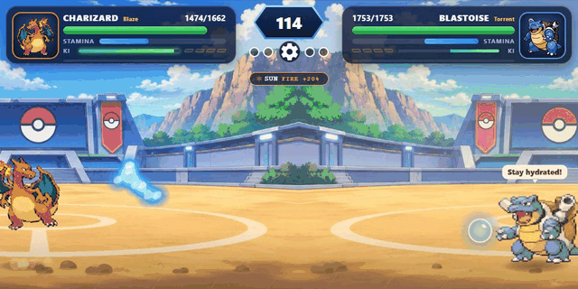

## Contents

- [Overview](#overview)
- [By the numbers](#by-the-numbers)
- [A tour of the game](#a-tour-of-the-game)
- [How types work](#how-types-work)
- [Moves and abilities](#moves-and-abilities)
- [Game modes](#game-modes)
- [Online 1v1](#online-1v1)
- [Controls](#controls)
- [Install and run](#install-and-run)
- [Project layout](#project-layout)
- [Credits](#credits)

## Overview

Poké Fighters Z takes the Pokémon data and turns it into a side-view fighter in the style of a Dragon Ball arena brawl. Every one of the 386 Pokémon is playable. A fighter is built from its PokeAPI entry: its types decide what it is strong and weak against, its learnset supplies the special moves you can equip, and its ability becomes an in-fight effect.

The whole game is plain HTML, CSS and JavaScript. There is no build step and no engine. The Android app is a thin WebView wrapper around the same files.

## By the numbers

  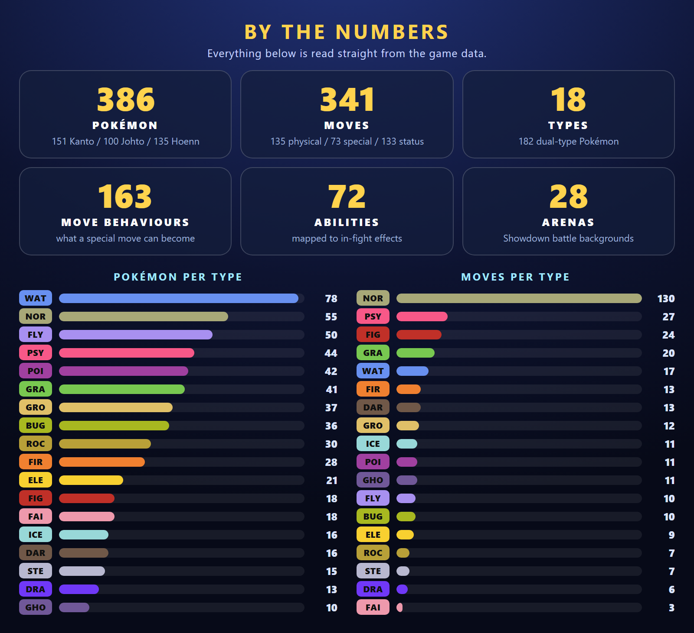

| | |
| --- | --- |
| Pokémon | 386 (151 Kanto, 100 Johto, 135 Hoenn), 182 of them dual-typed |
| Moves | 341, split into 135 physical, 73 special and 133 status moves |
| Average learnset | about 36 moves per Pokémon |
| Types | 18, including Dark, Steel and Fairy |
| Abilities | 72 distinct abilities |
| Move behaviours | 163 distinct in-fight behaviours that a special move can become |
| Arenas | 28 battle backgrounds |
| Highest base stat total | Mewtwo, Lugia, Ho-Oh and Rayquaza at 680 |

## A tour of the game

<table>
  <tr>
    <td width="50%">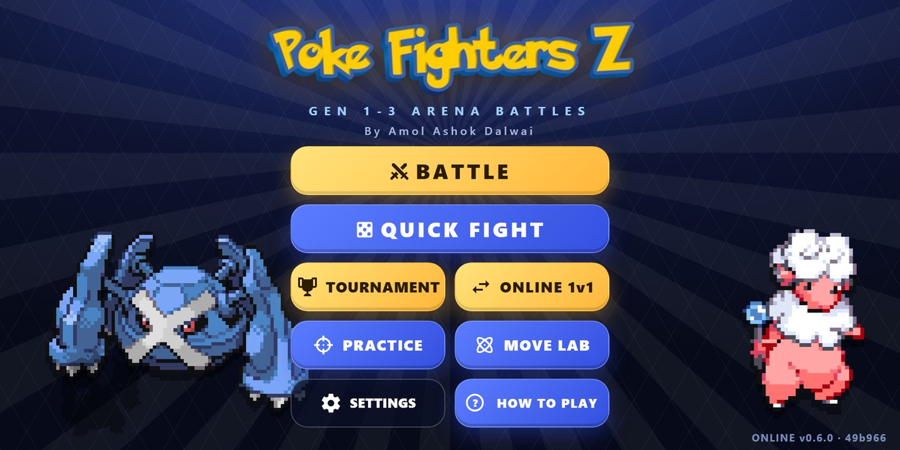 <b>Title screen.</b> Battle, quick fight, tournament, online, practice and the Move Lab.</td>
    <td width="50%">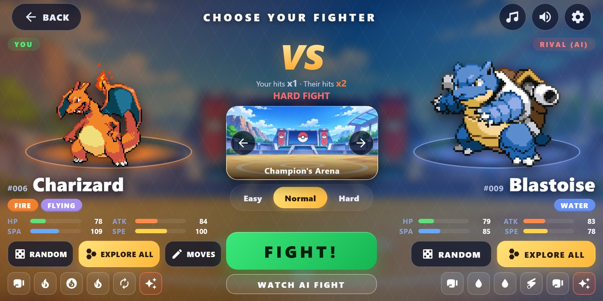 <b>Battle menu.</b> Pick both fighters and an arena. The centre panel shows how the type matchup plays out.</td>
  </tr>
  <tr>
    <td width="50%">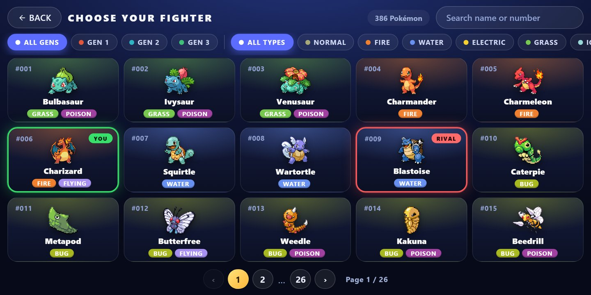 <b>Explore all.</b> Browse and search the full roster.</td>
    <td width="50%">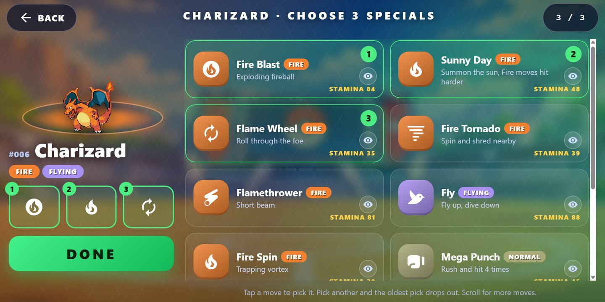 <b>Moves.</b> Choose which three special moves your fighter brings.</td>
  </tr>
  <tr>
    <td width="50%">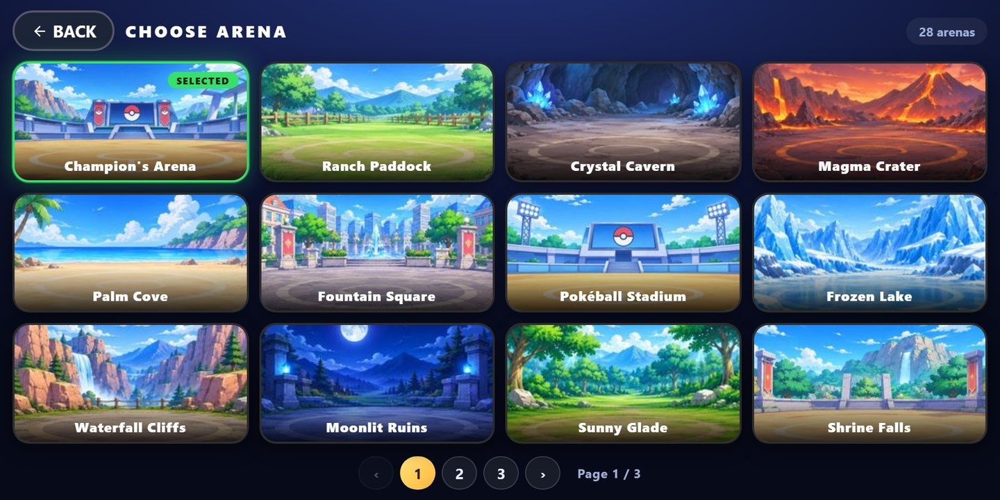 <b>Arenas.</b> 28 backgrounds, each with a preview card.</td>
    <td width="50%">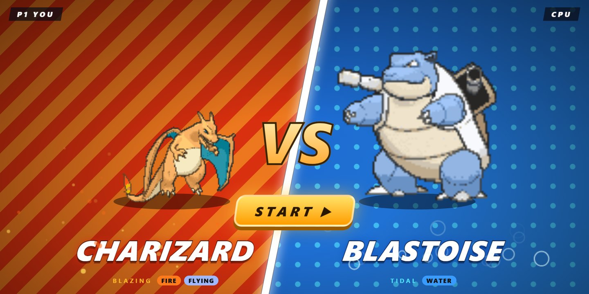 <b>Versus splash.</b> Types, ability and name for both sides before the bell.</td>
  </tr>
  <tr>
    <td width="50%">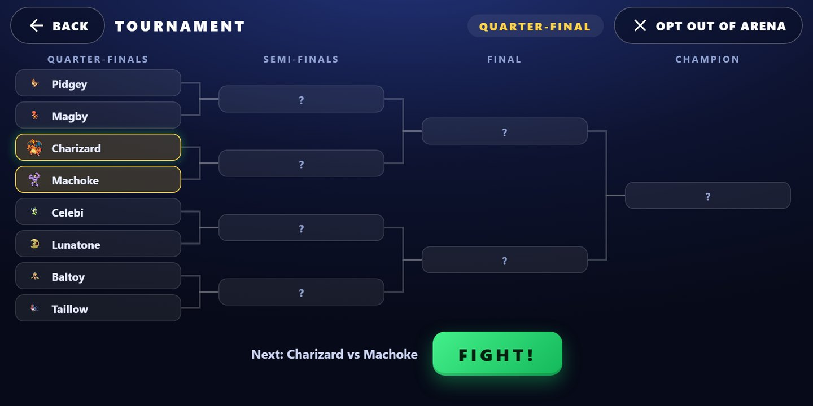 <b>Tournament.</b> An eight fighter bracket that gets harder every round.</td>
    <td width="50%">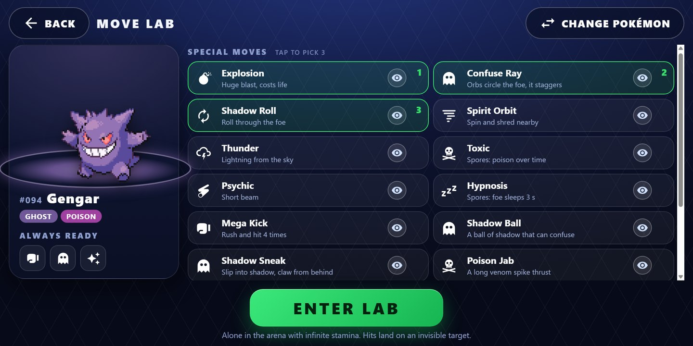 <b>Move Lab.</b> Try any special move alone in the arena with infinite stamina.</td>
  </tr>
</table>

  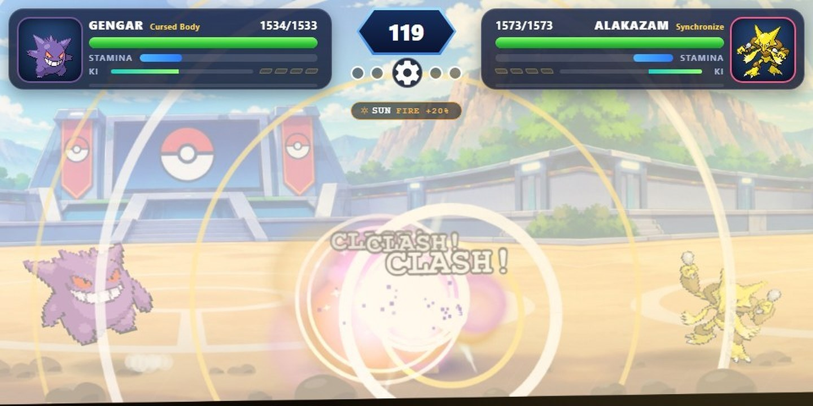
  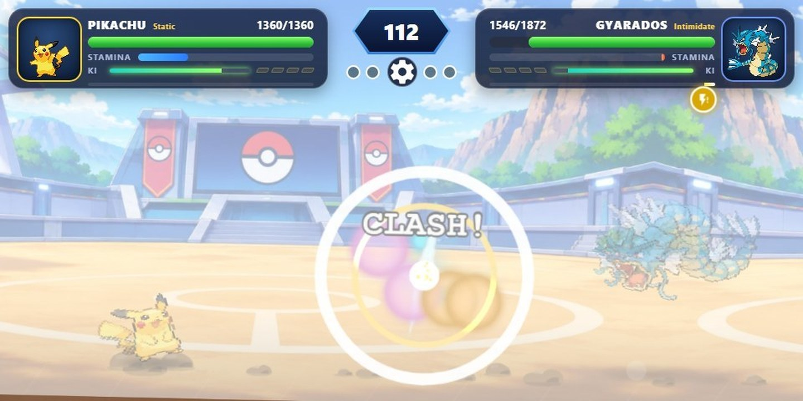

## How types work

Type matchups are the heart of the game, and they are not hand written. The chart in [`data/typechart.js`](data/typechart.js) is generated from PokeAPI and covers all 18 types, so a Fairy attack or a Steel defence behaves the way the current games say it should.

  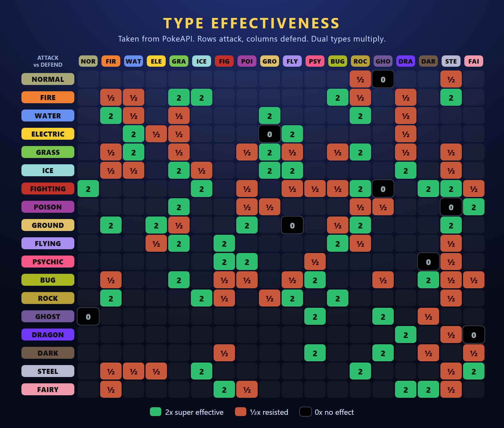

How the chart is applied in a fight:

- **Dual types multiply.** An attack is checked against each of the defender's types and the results are multiplied, so a Fire move against Grass and Bug hits for 4x. The final multiplier is clamped between 0.25x and 4x.
- **No effect is not zero.** An immunity still lets a sliver of damage through (15 percent) so a fight never becomes unwinnable.
- **Same type attack bonus.** A move that matches one of the attacker's own types gets a 1.15x boost.
- **You can see it coming.** The battle menu previews the matchup, for example "Your hits x1, Their hits x2, HARD FIGHT" for Charizard against Blastoise, and "EASY FIGHT" when you flip it.
- **You can see it land.** A super effective hit throws a large banner in the colour of the attacking type, and weak hits show as "NOT VERY EFFECTIVE".

  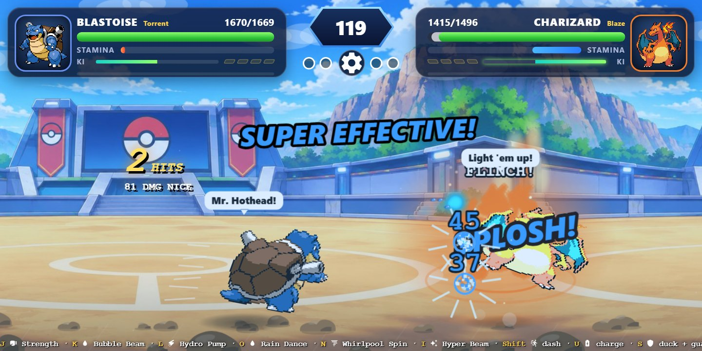 
  Blastoise against Charizard: Water into Fire.

<b>Strengths and weaknesses of every type</b> (generated from the game's own chart)

| Type | Hits super effectively | Weak to | Resists | Immune to |
| --- | --- | --- | --- | --- |
| Normal | - | Fighting | - | Ghost |
| Fire | Grass, Ice, Bug, Steel | Water, Ground, Rock | Fire, Grass, Ice, Bug, Steel, Fairy | - |
| Water | Fire, Ground, Rock | Electric, Grass | Fire, Water, Ice, Steel | - |
| Electric | Water, Flying | Ground | Electric, Flying, Steel | - |
| Grass | Water, Ground, Rock | Fire, Ice, Poison, Flying, Bug | Water, Electric, Grass, Ground | - |
| Ice | Grass, Ground, Flying, Dragon | Fire, Fighting, Rock, Steel | Ice | - |
| Fighting | Normal, Ice, Rock, Dark, Steel | Flying, Psychic, Fairy | Bug, Rock, Dark | - |
| Poison | Grass, Fairy | Ground, Psychic | Grass, Fighting, Poison, Bug, Fairy | - |
| Ground | Fire, Electric, Poison, Rock, Steel | Water, Grass, Ice | Poison, Rock | Electric |
| Flying | Grass, Fighting, Bug | Electric, Ice, Rock | Grass, Fighting, Bug | Ground |
| Psychic | Fighting, Poison | Bug, Ghost, Dark | Fighting, Psychic | - |
| Bug | Grass, Psychic, Dark | Fire, Flying, Rock | Grass, Fighting, Ground | - |
| Rock | Fire, Ice, Flying, Bug | Water, Grass, Fighting, Ground, Steel | Normal, Fire, Poison, Flying | - |
| Ghost | Psychic, Ghost | Ghost, Dark | Poison, Bug | Normal, Fighting |
| Dragon | Dragon | Ice, Dragon, Fairy | Fire, Water, Electric, Grass | - |
| Dark | Psychic, Ghost | Fighting, Bug, Fairy | Ghost, Dark | Psychic |
| Steel | Ice, Rock, Fairy | Fire, Fighting, Ground | Normal, Grass, Ice, Flying, Psychic, Bug, Rock, Dragon, Steel, Fairy | Poison |
| Fairy | Fighting, Dragon, Dark | Poison, Steel | Fighting, Bug, Dark | Dragon |

A few things the chart makes obvious: Steel resists ten types and is immune to Poison, Normal attacks never hit anything super effectively, Fighting and Ground each hit five types for double damage, and Grass and Rock are the most fragile defenders with five weaknesses each.

## Moves and abilities

**Moves.** All 341 moves come from PokeAPI with their type, power, accuracy, PP and class. Each Pokémon can use the moves PokeAPI lists in its learnset. A fighter brings three special moves of your choice (pick them with **Moves**, or try them first in the **Move Lab**) on top of its always-ready basic attacks.

**Move behaviours.** A special move is not just a number. Moves are mapped to one of 163 in-fight behaviours such as a beam, a rain of projectiles, a tornado, a dash, a geyser, a vine whip, a self destruct, a heal or a buff. The behaviour decides how the move travels, how it looks and what extra effect it has, while the move's own type decides what it is strong against.

**Abilities.** Each Pokémon's real PokeAPI ability is mapped to an in-fight effect. The name appears next to the fighter in the health bar, for example Blaze on Charizard and Torrent on Blastoise. Anything unmapped falls back to an effect based on the Pokémon's type.

**Arenas.** 28 backgrounds taken from Pokémon Showdown. You choose one before the fight, and weather moves such as Sunny Day and Rain Dance change the battlefield.

## Game modes

| Mode | What it is |
| --- | --- |
| Battle | Choose your fighter, the rival, the arena and the difficulty (Easy, Normal, Hard). |
| Quick fight | Your fighter against a random rival, straight into the arena. |
| Tournament | An eight fighter knockout bracket. Opponents hit harder each round, and you can leave and return to a tournament in progress. |
| Online 1v1 | Fight a friend on another phone over Wi-Fi. |
| Practice | A training dummy that stands still or guards. |
| Move Lab | A sandbox with infinite stamina for trying every special move. |
| Watch AI fight | Two AI fighters battle it out, handy for seeing a matchup. |

## Online 1v1

  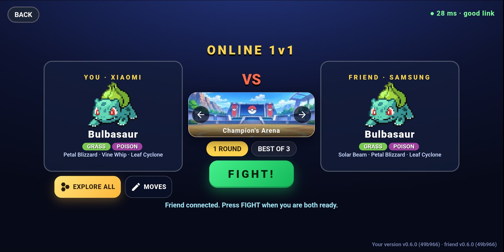

1. Enter your name (it is required). One player picks **ONLINE 1v1, HOST A ROOM** and shares the 4-letter room code.
2. The other player picks **JOIN A ROOM** and types the code.
3. Each player chooses a Pokémon and moves with **EXPLORE ALL** and **MOVES**. The host picks the arena and the number of rounds, and both players see the same choices.
4. The host presses **FIGHT!**

How it stays smooth and fair:

- **Deterministic lockstep.** Both phones run the same simulation at a fixed 60 ticks per second from the same random seed, and only the controls are sent over the network. Matches do not drift apart, and a periodic state hash check reports any desync.
- **Adaptive input buffer.** The game keeps a few ticks of input buffered and grows the buffer when the Wi-Fi gets jittery, so short hiccups do not freeze the fight.
- **Live link status.** A small pill under the settings gear shows the round trip time, any hitches and the current buffer.
- **Version check.** The lobby compares the game version and a fingerprint of the game files. If they differ, FIGHT stays disabled and the lobby tells the player to update.
- **Wi-Fi only.** Mobile data is not supported. The public PeerJS broker is used to introduce the two phones, so both still need internet access to connect.

## Controls

| Action | Keyboard |
| --- | --- |
| Move | A / D or Left / Right |
| Jump | W, Up or Space |
| Dash | Shift, or double-tap a direction |
| Attacks | J, K, L, O, N, I |
| Grab | G |
| Switch lane | Q (back) / E (front) |
| Pause | P or Esc |

On phones the same actions are on-screen buttons. The in-game **How to Play** screen walks through every move with a replay.

## Install and run

**Android.** Download the APK from the [latest release](https://github.com/amoldalwai/PokeFightersz/releases/latest) and allow installs from unknown sources (it is a debug-signed build). A new release installs over the old one and keeps your data. The main menu has a **CHECK FOR UPDATES** button that compares your version with the latest GitHub release, offers to download it, and lets you choose **LATER**. Online matches need both players on the same version.

**Browser.** Open https://amoldalwai.github.io/PokeFightersz/.

**Run locally.** There is no build step. Serve the folder with any static server, for example `npx serve .`, then open the address it prints. Add `?demo=1` to watch two AI fighters.

## Project layout

| Path | Contents |
| --- | --- |
| `index.html` | Page structure, menus and most of the styling |
| `game.js` | The game: fighters, moves, AI, rendering, menus, tournament |
| `net.js`, `net.css` | Online 1v1 lobby, lockstep networking and the update check |
| `detmath.js` | Deterministic math so both phones compute identical fights |
| `data/` | Generated data: `pokedex.js` (stats, types, learnsets, moves), `typechart.js`, `abilities.js`, plus move effect tables |
| `assets/` | Sprites, icons, arena backgrounds, music and sound effects |
| `howto.html` | The interactive how to play guide |
| `docs/` | Screenshots used in this README |

The data files in `data/` are generated from PokeAPI and marked as generated, so they are not meant to be edited by hand.

## Credits

- Pokémon data (stats, types, moves, abilities, learnsets and the type chart) from [PokeAPI](https://pokeapi.co/).
- Animated sprites from the Pokémon Database, and battle backgrounds from Pokémon Showdown.
- Online matchmaking uses [PeerJS](https://peerjs.com/).
- Created by Amol Ashok Dalwai.

Pokémon and all related names are trademarks of Nintendo, Creatures Inc. and Game Freak. This is an unofficial, non-commercial fan project.
