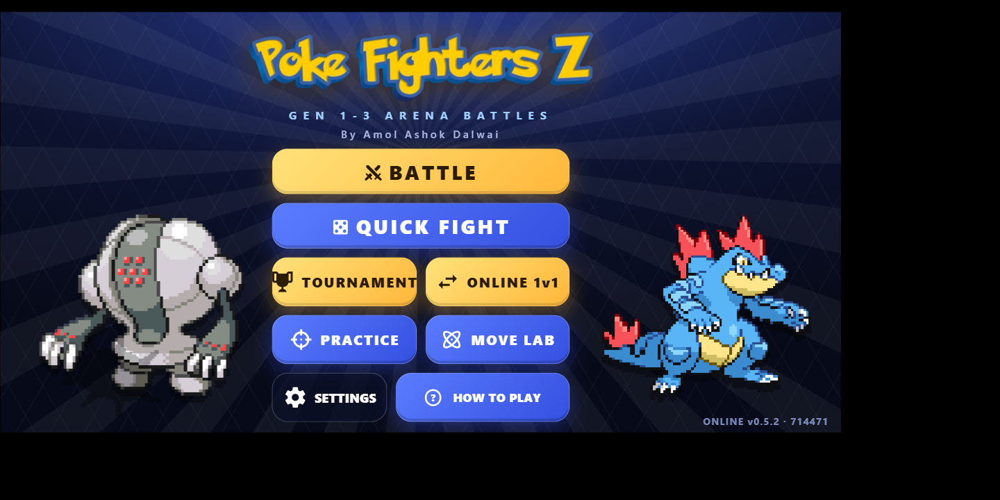
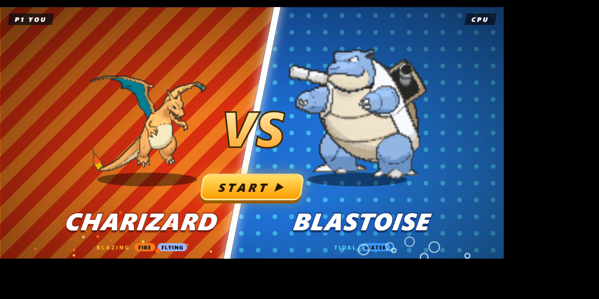
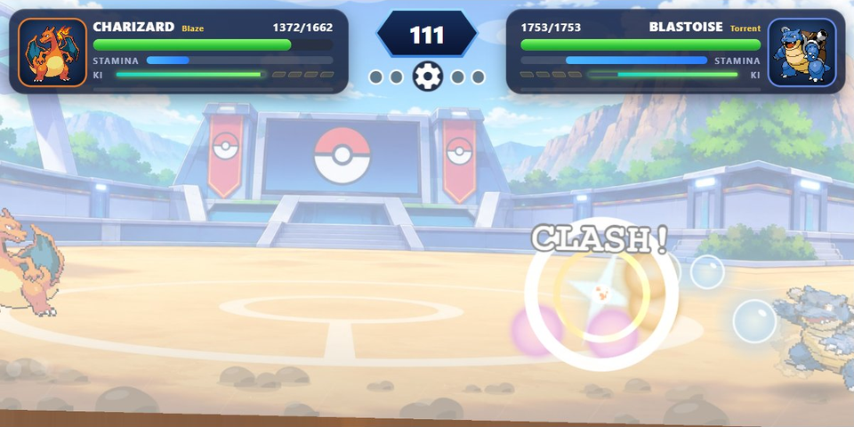
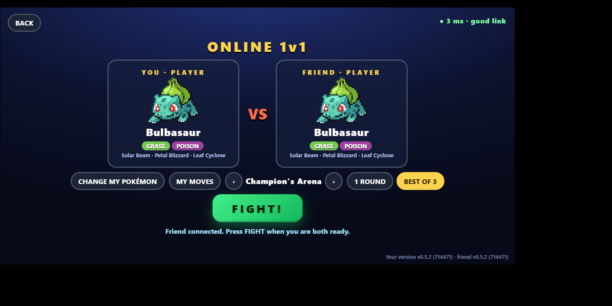

# Poké Fighters Z

A 2D Pokémon arena fighter (Gen 1-3) that runs in the browser and as an Android app. Pick a Pokémon, use its real moves, and fight a CPU, run a tournament, or battle a friend online over Wi-Fi.


| Title | Versus | Fight |
| --- | --- | --- |
|  |  |  |

## Play

- **Web:** https://amoldalwai.github.io/PokeFightersz/
- **Android:** download the APK from the [latest release](https://github.com/amoldalwai/PokeFightersz/releases/latest) and allow installs from unknown sources (debug-signed build).

## Modes

- **Battle / Quick Fight:** one fight against a CPU opponent.
- **Tournament:** a bracket of fights.
- **Online 1v1:** a Wi-Fi battle against a friend (see below).
- **Practice:** a training dummy with no pressure.
- **Move Lab:** a practice mode for trying out moves.

## Online 1v1



1. One player picks **ONLINE 1v1 > HOST A ROOM** and shares the 4-letter room code.
2. The other player picks **JOIN** and enters the code.
3. Each player chooses a Pokémon and moves (**MY MOVES**), then either player sets the arena and rounds and both press **FIGHT!**

Notes:

- Both players should be on Wi-Fi and need the **same version of the game**. A mismatch is shown in the lobby and FIGHT stays disabled until both versions match.
- Mobile data is not supported.
- Matches use deterministic lockstep: only inputs are exchanged and both devices run the same simulation, with a periodic state hash check to detect desyncs. A ping indicator shows link quality.
- Connection setup uses the public PeerJS broker, so internet access is still needed to connect.

## Controls (keyboard)

| Action | Keys |
| --- | --- |
| Move | A / D or Left / Right |
| Jump | W, Up or Space |
| Dash | Shift, or double-tap a direction |
| Attacks | J, K, L, O, N, I |
| Grab | G |
| Switch lane | Q (back) / E (front) |
| Pause | P or Esc |

On phones, use the on-screen touch buttons. The in-game **How to Play** screen shows each move.

## Run locally

The game is plain HTML, CSS and JavaScript with no build step. Serve the folder with any static server, for example:

```
npx serve .
```

then open the printed address. `?demo=1` runs an AI vs AI fight.

## Android

The Android app is a thin WebView wrapper that bundles these files. Online mode needs the `INTERNET` permission.

## Credits

Created by Amol Ashok Dalwai. Pokémon is a trademark of Nintendo, Creatures Inc. and Game Freak; this is an unofficial fan project.
